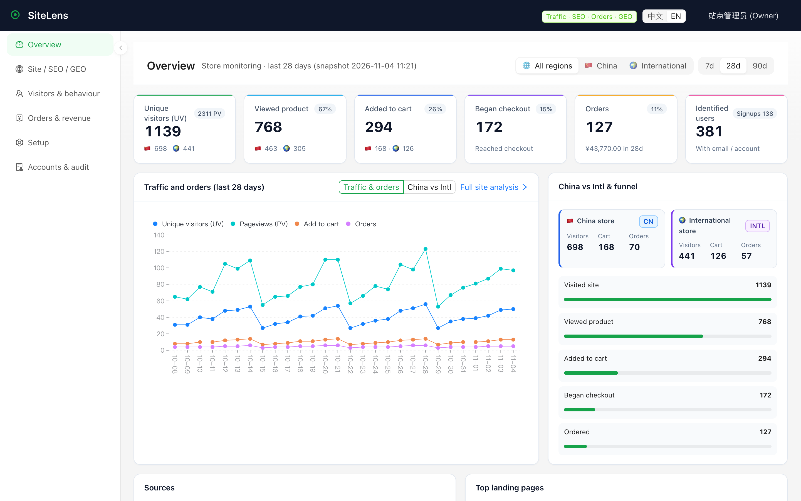
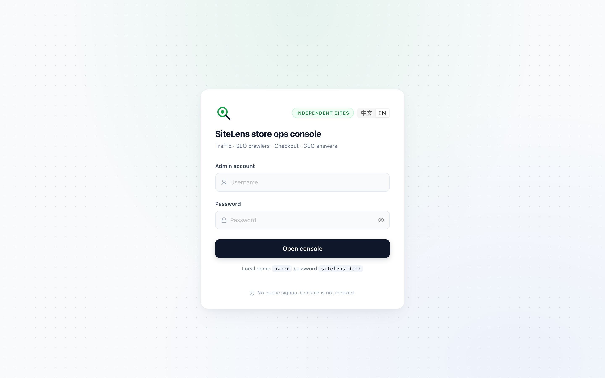
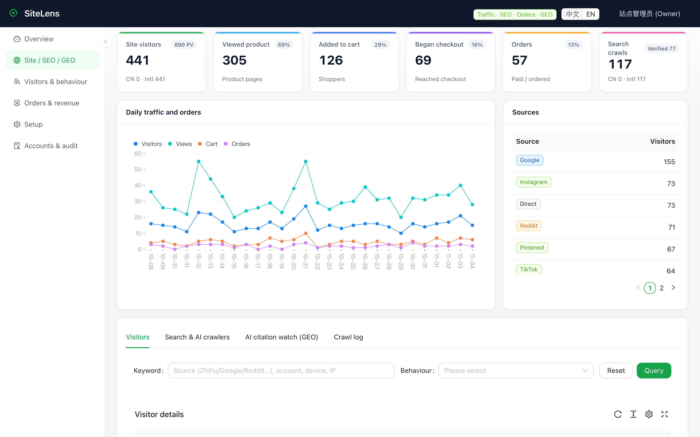
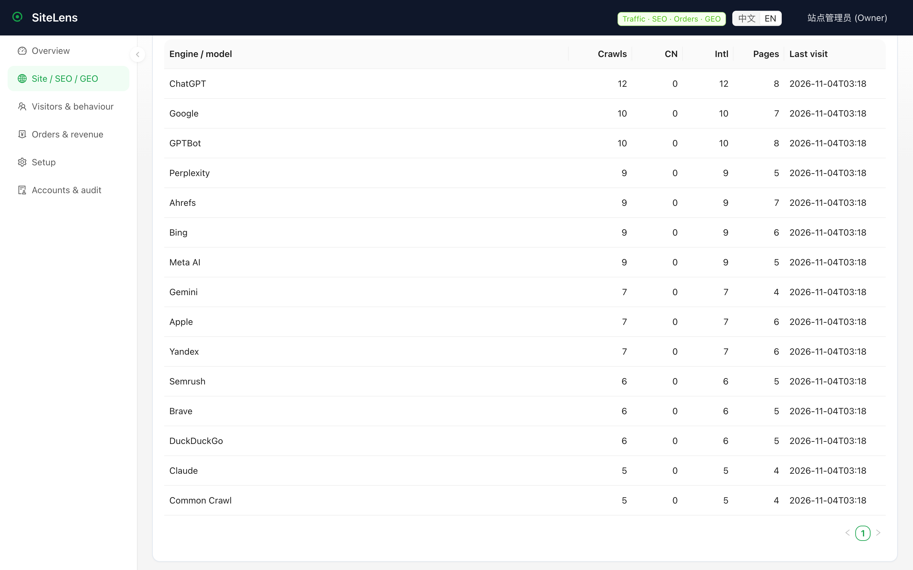
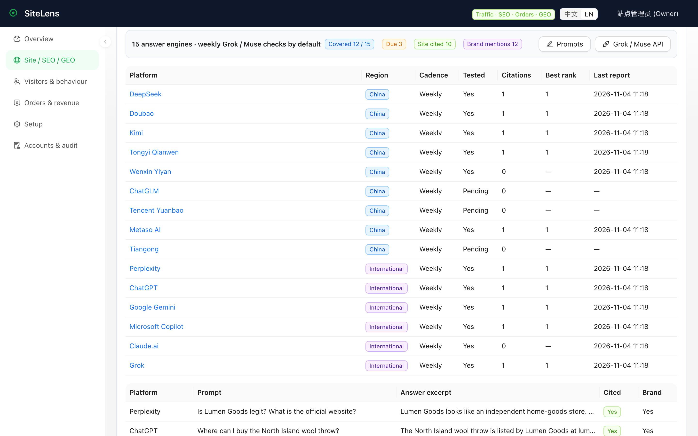
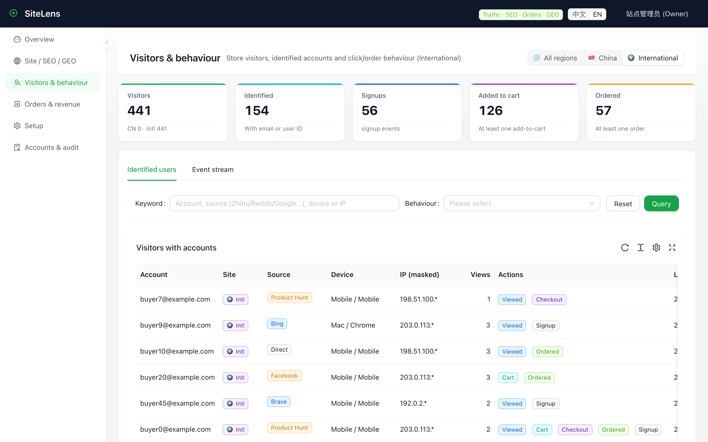
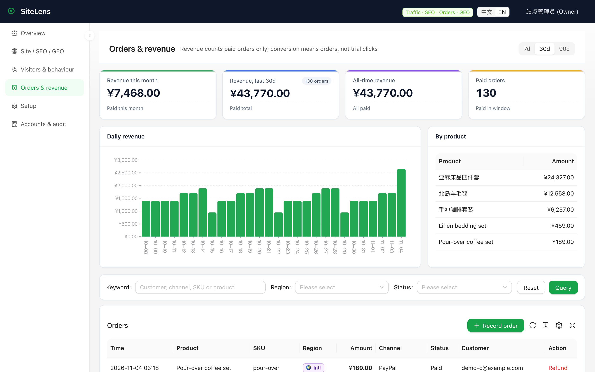
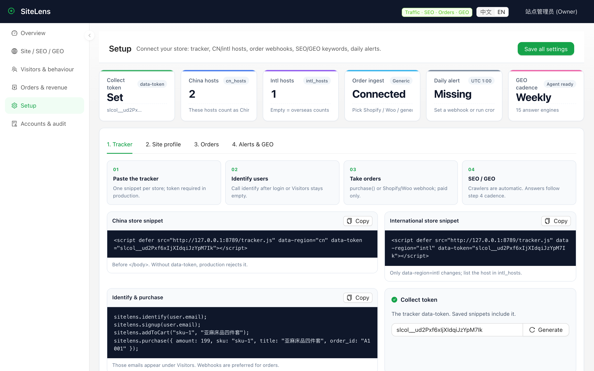

<div align="center">

# SiteLens

### Self-hosted ops console for independent stores

**Traffic · SEO crawlers · Checkout conversion · GEO citations**

Shopify, WooCommerce, or a China + international pair. Your SQLite. No public signup. No marketing-cloud tax.

[](LICENSE)
[](https://github.com/lzq-0529/sitelens)


[简体中文](README.zh-CN.md) · English · **[30-minute setup](docs/getting-started.md)** · [Deploy](docs/deploy.md) · [Tracker](docs/tracker.md) · [Roadmap](docs/roadmap.md) · Live product behind it: [qingjiaolab.com](https://qingjiaolab.com)

`#analytics` `#seo` `#geo` `#ecommerce` `#shopify` `#woocommerce` `#self-hosted` `#web-analytics`

</div>

<p align="center">
  
</p>

> **Real site behind it, demo data in front of you.** SiteLens is extracted from the production ops monitoring behind **[qingjiaolab.com](https://qingjiaolab.com)** — 青椒智能脱敏 (Qingjiao Data Redaction), private document redaction before files go to AI. Visit the live site to see the product whose traffic, crawlers, and AI mentions this console was built to watch. Every screenshot in this README is a **mock demo store** (流明好物 / Lumen Goods) on purpose: no real Qingjiao traffic, accounts, or orders are shown.

The funnel is a **store** funnel, not a SaaS “activate trial” funnel:

```
visit → view product → add to cart → checkout → paid order
```

China and international hosts are counted separately. Search-engine / AI crawlers are not mixed into human UV.

## Why independent-store operators use this

Google Analytics will tell you a session happened. Your Shopify admin will tell you an order happened. Search Console will tell you Google visited. ChatGPT will not tell you whether it recommended your URL.

SiteLens is the one private console that puts those four questions on one desk:

| Question | Where you see it |
| --- | --- |
| Who came, from Zhihu / 小红书 / Baidu / Google / UTM? | Overview + site sources |
| Did Baidu, Googlebot, GPTBot, Ahrefs actually crawl us? | **SEO · search engines & AI crawlers** |
| Who is the visitor (email / account), and did they buy? | Visitors + orders |
| Do DeepSeek / 豆包 / ChatGPT / Perplexity cite the store? | **GEO citation watch** |

Built for people who run a store, not for people who collect event soup.

<p align="center">
  
  &nbsp;
  
</p>

## The console (real pages)

### 1. Overview — daily pulse

UV / PV, product views, cart, checkout, paid orders, identified users. China vs international side by side. Click a KPI to jump into the matching page.

### 2. SEO is first-class (not a footnote)

This was always in the product. It belongs on the README.

<p align="center">
  
</p>

After you paste `tracker.js`, SiteLens classifies every hit:

- **Humans vs bots** — toggle “只看真人 / 全部访问” so Googlebot does not inflate conversion
- **Search engines** — Google, Bing, Baidu, 搜狗, 360, 神马, DuckDuckGo, Yandex, Applebot, Amazonbot
- **SEO tools** — Ahrefs, Semrush, Petal
- **AI crawlers** — GPTBot, ChatGPT, Claude, Gemini, Perplexity, DeepSeek, Kimi, 豆包, 头条/抖音 Bytespider
- **Sources & campaigns** — 知乎, 小红书, 微信, 抖音, B站, 微博, 百度, Google, Bing, plus raw `utm_source`
- **Landing pages** — which path the visitor or crawler opened
- **Crawl log** — engine, path, status, IP, verified vs guessed

Open **站点 / SEO / GEO → 搜索引擎与 AI 抓取**. The sixth KPI on that page is “搜索引擎抓取”.

### 3. GEO — will AI recommend your store this week?

<p align="center">
  
</p>

Fifteen consumer answer engines ship in the box:

国内：DeepSeek · 豆包 · Kimi · 通义 · 文心 · 清言 · 元宝 · 秘塔 · 天工  
海外：Perplexity · ChatGPT · Gemini · Copilot · Claude · Grok

SiteLens does **not** log into those products. A weekly agent (Grok, Muse, or your script) pulls due prompts from `GET /api/geo/tasks` and posts answers to `POST /api/geo/ingest`. Scoring uses **your** brand, domains, keywords, and competitors.

Protocol: [docs/geo-agent.md](docs/geo-agent.md).

### 4. Identified visitors and paid orders

<p align="center">
  
  &nbsp;
  
</p>

- Call `sitelens.identify(email)` after login or the visitors page stays empty
- Ingest **paid** orders from Shopify `orders/paid`, WooCommerce, or a generic HMAC webhook
- Revenue is money, not “click the CTA”

### 5. Settings — a setup workbench, not a long form

<p align="center">
  
</p>

Brand, aliases, `cn_hosts` / `intl_hosts`, collect token, Shopify / Woo / generic secrets, daily alert webhook, GEO agent token. Production (`SITELENS_ENV=production`) refuses an open collect endpoint.

## 30 minutes to a live store

```bash
python3 -m venv .venv && source .venv/bin/activate
pip install -r requirements.txt
export SITELENS_DATA_DIR="$PWD/.local"
python -m sitelens.manage seed-demo
(cd web && npm ci && npm run build)
python -m sitelens
```

Open **http://127.0.0.1:8788**

| | |
| --- | --- |
| Username | `owner` |
| Password | `sitelens-demo` |

Then on the real store:

```html
<script defer src="https://sitelens.yourdomain.com/tracker.js" data-region="cn" data-token="slcol_..."></script>
```

```js
sitelens.identify(user.email);
sitelens.addToCart("sku-1", "Linen bedding");
sitelens.purchase({ amount: 199, sku: "sku-1", title: "Linen bedding", order_id: "A1001" });
```

Overseas store: `data-region="intl"`. Full path (identity, webhooks, GEO cron, daily alerts): **[docs/getting-started.md](docs/getting-started.md)**. Docker: [docs/deploy.md](docs/deploy.md).

Empty console instead of demo data:

```bash
python -m sitelens.manage create-owner --username you
```

## How it compares — and what is still missing

Umami/Plausible do simple traffic better today (realtime, multi-site, English UI). Matomo is deeper. PostHog does replay/flags. Uptime Kuma answers “is it up?”. SiteLens is the store-shaped one: CN+intl hosts, named Zhihu/小红书/Baidu sources, search/AI crawlers kept instead of filtered away, cart→paid-order funnel, and Chinese + global GEO.

We keep the honest gap list in the open — realtime, English UI, multi-store, campaign attribution, export/retention, richer alerts, uptime/SSL mini-checks are P0/P1, not hidden fine print: **[docs/roadmap.md](docs/roadmap.md)**.

## What this is not

Not GA4. Not a license manager. Not a desktop updater. Not one vendor’s internal ops console. Activation codes, release trains, device control, and “try the workbench” were left out on purpose so a stranger’s Shopify / Woo / custom store can use this.

## Stack

FastAPI + SQLAlchemy / SQLite · React + Ant Design Pro · cookie auth (`owner` / `viewer`) · MIT

```bash
python -m unittest discover -s tests
```

## Topics

`analytics` · `seo` · `geo` · `ecommerce` · `shopify` · `woocommerce` · `self-hosted` · `web-analytics` · `conversion-tracking` · `crawler` · `dashboard` · `fastapi` · `privacy`

If you run an independent store and this saves you a tab, star the repo so the next operator can find it.
