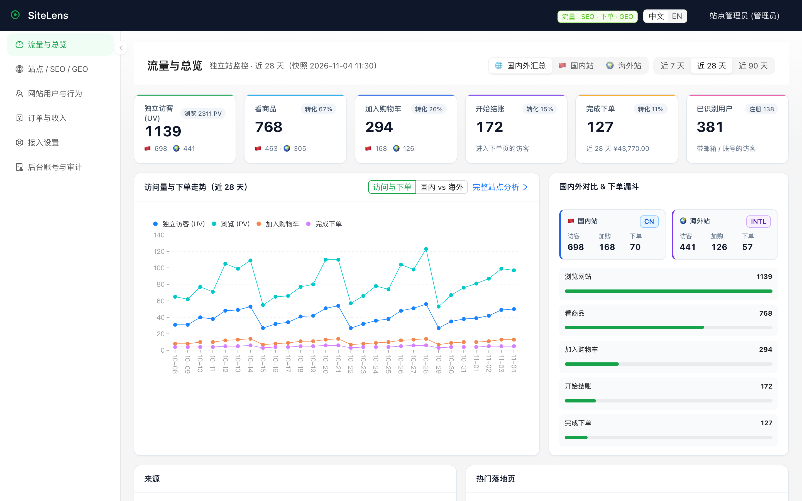
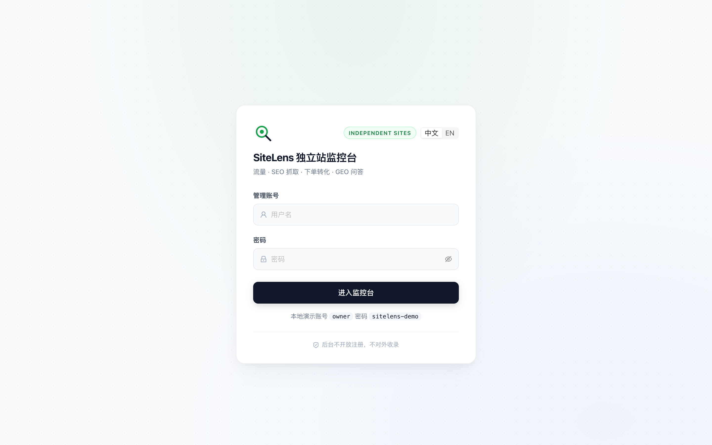
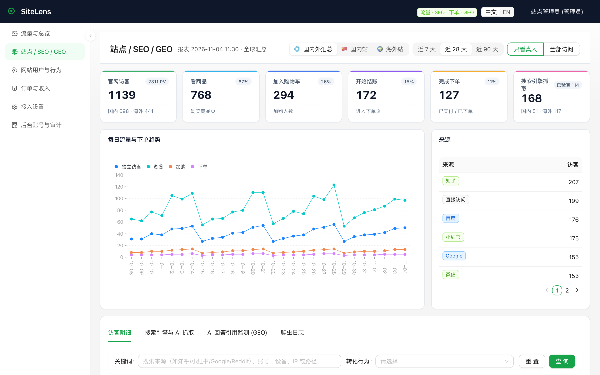
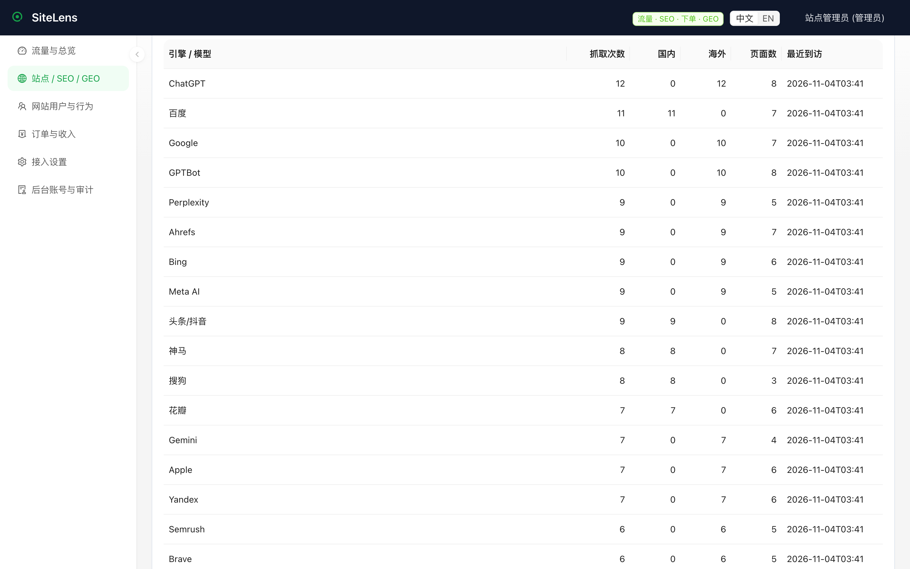
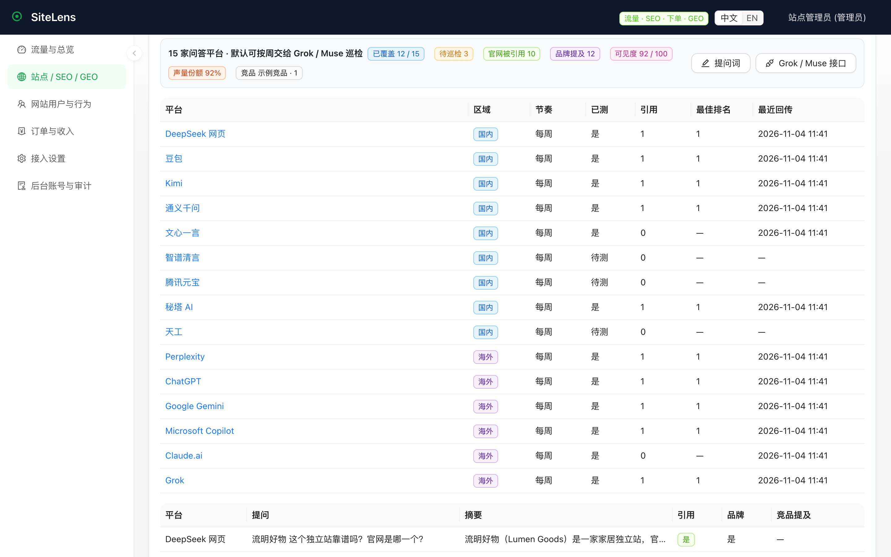
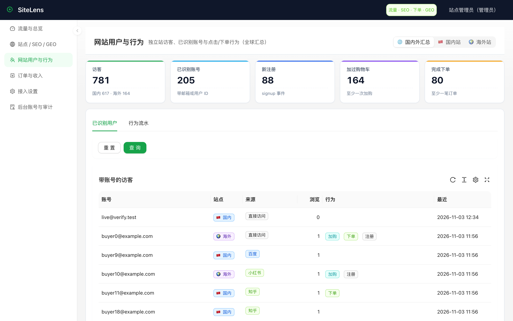
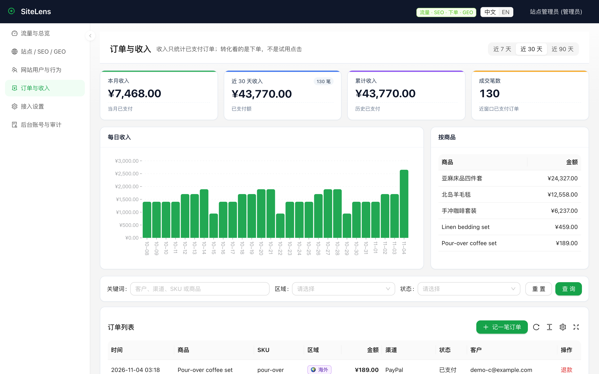
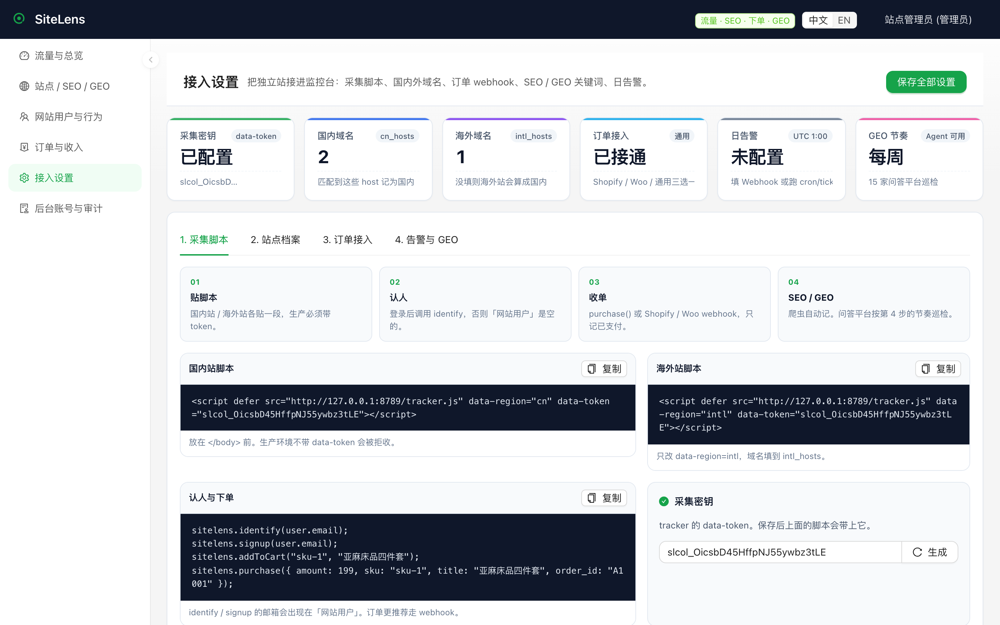

<div align="center">

# SiteLens 独立站运营监控台

### 谁来了、搜索引擎有没有抓、谁加了购、谁付了款、AI 会不会推荐你

给 **Shopify / WooCommerce / 自建国内站 + 海外站** 用的自托管后台。数据在你自己的机器上，不开放注册，不把订单交给广告云。

[](LICENSE)
[](https://github.com/lzq-0529/sitelens)


[English](README.md) · 简体中文 · **[30 分钟接入](docs/getting-started.zh-CN.md)** · [部署](docs/deploy.md) · [采集脚本](docs/tracker.md) · [路线图](docs/roadmap.zh-CN.md) · 背后的真实产品：[qingjiaolab.com](https://qingjiaolab.com)

`#独立站` `#运营监控` `#SEO` `#GEO` `#Shopify` `#WooCommerce` `#自托管` `#转化`

</div>

<p align="center">
  
</p>

> **真实在用，展示用演示数据。** SiteLens 是从 **[qingjiaolab.com](https://qingjiaolab.com)**（青椒智能脱敏：文件交给 AI 前先脱敏）生产环境背后的运营监控里提炼出来的。点开官网，就能看到这套监控原本在看的那个真实产品长什么样。本 README 的所有截图都故意用**演示店**（流明好物）数据：不展示青椒官网的真实流量、账号和订单。

漏斗按 **店** 来，不是按「立即体验」：

```
浏览网站 → 看商品 → 加入购物车 → 开始结账 → 完成支付
```

国内站和海外站拆开算。百度 / Google / GPTBot 不会掺进真人 UV。

## 做独立站的人，后台通常是散的

| 你现在的工具 | 它不告诉你的 | SiteLens 这一页 |
| --- | --- | --- |
| GA / 百度统计 | 谁加了购、谁付了款 | 总览漏斗 + 订单收入 |
| Search Console / 站长平台 | 爬虫来了有没有转化 | **搜索引擎与 AI 抓取** + 落地页 |
| Shopify / Woo 后台 | 这个买家昨天从知乎还是小红书来的 | 已识别用户 + 来源 |
| 自己去问 ChatGPT | 15 家问答平台这周提没提你 | **GEO 引用监测** |

流量、**SEO**、转化、GEO，本来就该是同一套运营监控，不该四个标签页来回切。

<p align="center">
  
  &nbsp;
  
</p>

## 打开后台你能看到什么（都是真实页面）

### 1. 流量与总览

近 7 / 28 / 90 天 UV、PV、看商品、加购、结账、支付、已识别用户。国内 / 海外对照，下单漏斗一眼看到掉在哪一层。

### 2. SEO：搜索引擎和 AI 到底有没有来抓

产品里一直有，以前 README 没写清楚。贴上 `tracker.js` 就会记。

<p align="center">
  
</p>

- **人机分开**：页面上有「只看真人 / 全部访问」，爬虫不会把转化率做假
- **搜索引擎**：Google、Bing、百度、搜狗、360、神马、DuckDuckGo、Yandex、Applebot
- **SEO 工具**：Ahrefs、Semrush、Petal
- **AI 爬虫**：GPTBot、ChatGPT、Claude、Gemini、Perplexity、DeepSeek、Kimi、豆包、头条/抖音 Bytespider
- **来源与 UTM**：知乎、小红书、微信、抖音、B站、微博、百度、Google，以及 `utm_source`
- **落地页 + 爬虫日志**：谁抓了哪条路径、状态码、IP、是否验真

进 **站点 / SEO / GEO →「搜索引擎与 AI 抓取」**。这一页第六个指标就是「搜索引擎抓取」。

### 3. GEO：AI 问答这周会不会引用你的官网

<p align="center">
  
</p>

内置 15 家消费级问答：

国内：DeepSeek · 豆包 · Kimi · 通义 · 文心 · 清言 · 元宝 · 秘塔 · 天工  
海外：Perplexity · ChatGPT · Gemini · Copilot · Claude · Grok

SiteLens **不会**自己去登录这些网页。每周用 Grok / Muse 或你自己的脚本：

1. `GET /api/geo/tasks` 拿走到期的平台和提问词
2. 去问
3. `POST /api/geo/ingest` 把回答和引用来源传回来

打分只用你配置的品牌、域名、关键词、竞品。协议见 [docs/geo-agent.md](docs/geo-agent.md)。

### 4. 认得出人，收得到钱

<p align="center">
  
  &nbsp;
  
</p>

- 用户登录后调用 `sitelens.identify(email)`，否则「网站用户」是空的
- 订单走 Shopify `orders/paid`、WooCommerce 或通用 HMAC webhook
- 收入只统计已支付，不是点了按钮

### 5. 接入设置：就绪状态 + 四步向导

<p align="center">
  
</p>

品牌、别名、`cn_hosts` / `intl_hosts`、采集密钥、Shopify / Woo / 通用密钥、日告警 Webhook、GEO Token。生产环境 `SITELENS_ENV=production` 会拒收不带 token 的采集。

## 三十分钟先跑起来

```bash
python3 -m venv .venv && source .venv/bin/activate
pip install -r requirements.txt
export SITELENS_DATA_DIR="$PWD/.local"
python -m sitelens.manage seed-demo
(cd web && npm ci && npm run build)
python -m sitelens
```

浏览器打开 **http://127.0.0.1:8788**

| | |
| --- | --- |
| 账号 | `owner` |
| 密码 | `sitelens-demo` |

真站贴这一段（海外站把 `data-region` 改成 `intl`）：

```html
<script defer src="https://sitelens.yourdomain.com/tracker.js" data-region="cn" data-token="slcol_..."></script>
```

```js
sitelens.identify(user.email);
sitelens.addToCart("sku-1", "亚麻床品四件套");
sitelens.purchase({ amount: 199, sku: "sku-1", title: "亚麻床品四件套", order_id: "A1001" });
```

认人、收单、GEO 巡检、日告警的完整顺序：[docs/getting-started.zh-CN.md](docs/getting-started.zh-CN.md)。Docker 见 [docs/deploy.md](docs/deploy.md)。

只要空后台，不要演示数据：

```bash
python -m sitelens.manage create-owner --username 你的名字
```

## 和同类比，还缺什么（不藏着）

Umami/Plausible 今天把简单流量做得更好（实时、多站点、英文界面），Matomo 更深，PostHog 有回放和实验，Uptime Kuma 回答「网站活没活」。SiteLens 是店铺形状的那个：国内外域名、知乎/小红书/百度命名来源、搜索引擎/AI 爬虫不被过滤掉、加购到付款漏斗、国内+海外 GEO。

差距清单公开维护——实时访客、英文界面、多店铺、投放归因、导出与保留、更多告警通道、可用性/证书小监控都在路线图里：**[docs/roadmap.zh-CN.md](docs/roadmap.zh-CN.md)**。

## 刻意没放进来的

授权码、桌面端发版、设备管控、工作台试用——那些是某一家产品自己的运营，不是独立站通用能力。SiteLens 只留店主能复用的：流量、SEO、转化、GEO。

## 技术栈

FastAPI + SQLAlchemy / SQLite · React + Ant Design Pro · Cookie 登录（管理员 / 只读）· MIT

```bash
python -m unittest discover -s tests
```

## 标签

`独立站` · `运营监控` · `SEO` · `GEO` · `Shopify` · `WooCommerce` · `自托管` · `网站分析` · `转化追踪` · `爬虫监测`

如果你也在跑独立站，点一颗 Star，让下一个店主能搜到这个后台。
